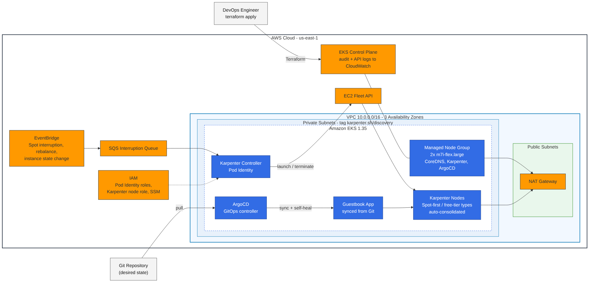
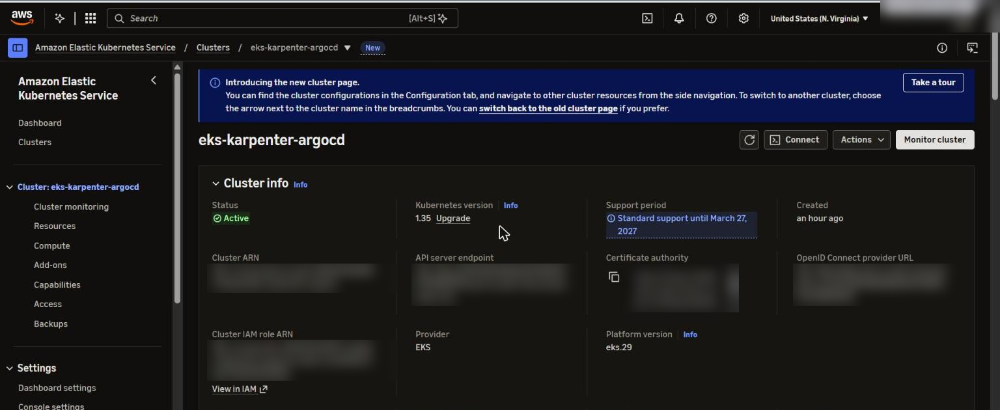
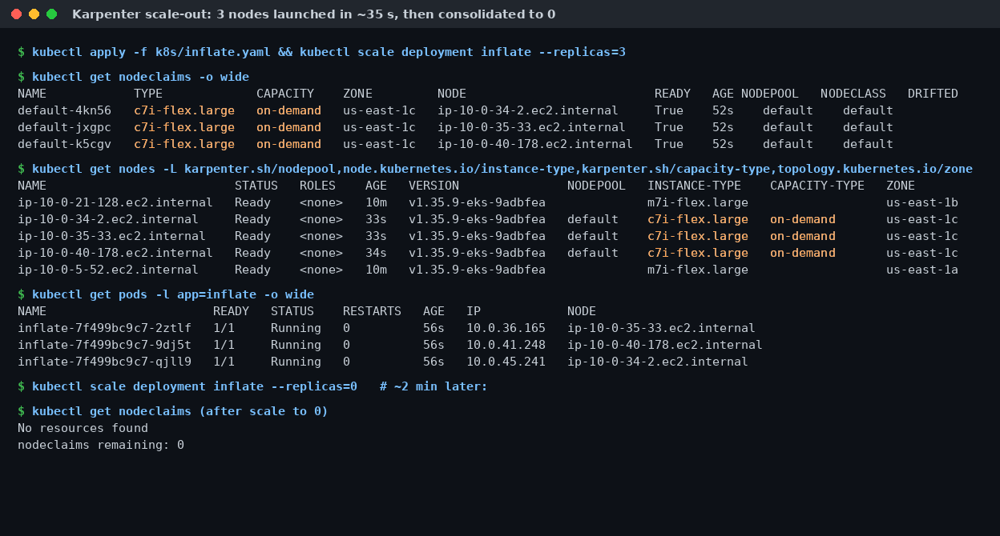
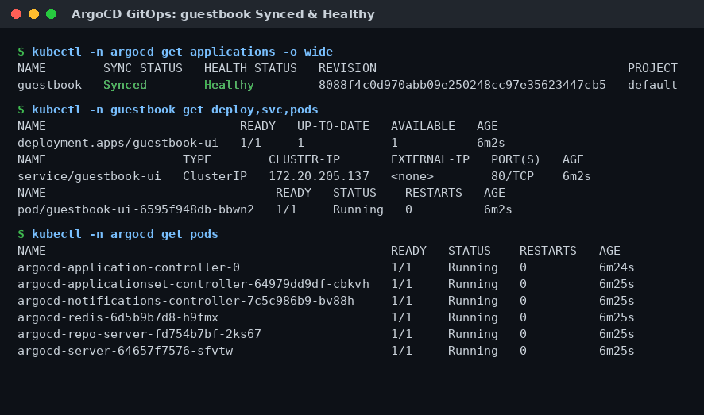
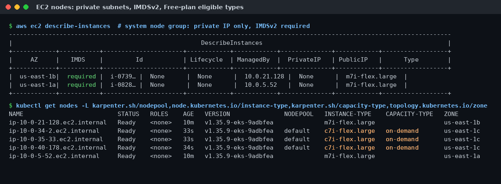

# Production EKS with Karpenter Autoscaling & ArgoCD GitOps


A fully reproducible, production-style Amazon EKS platform built with modular Terraform. **Karpenter** provisions right-sized nodes in about 35 seconds (measured), Spot-first with On-Demand fallback, or restricted to free-tier eligible types on AWS Free-plan accounts. **ArgoCD** keeps workloads continuously in sync with Git.



## Verified run (live deployment, November 2026)

Deployed end to end with the code in this repo, demoed, then destroyed to $0.

| Check | Result |
|---|---|
| EKS control plane | `Active`, Kubernetes **1.35** (standard support) |
| System nodes | 2 × `m7i-flex.large`, private subnets, IMDSv2 `required`, no public IP |
| Karpenter scale-out | 3 pending pods → **3 new nodes Ready in ~35 s** (`c7i-flex.large`, On-Demand) |
| Karpenter consolidation | Scaled to 0 → all 3 nodes removed within ~2 min |
| ArgoCD | `guestbook` **Synced / Healthy**, auto-sync with prune + self-heal |
| Teardown | `terraform destroy` + orphan audit |

| | |
|---|---|
|  |  |
|  |  |

*Screenshots 02–04 are rendered from the captured command output of the live run (`scripts/autopilot.ps1`). Account IDs, ARNs and endpoints are redacted.*

## What this demonstrates

| Capability | Implementation |
|---|---|
| Infrastructure as Code | Modular Terraform (`vpc.tf`, `eks.tf`, `karpenter.tf`, `argocd.tf`) using pinned community modules |
| Networking | 3-AZ VPC, private worker subnets, single NAT for cost, subnet tags for ELB + Karpenter discovery |
| Autoscaling | Karpenter v1 `NodePool` + `EC2NodeClass`: Spot/On-Demand, amd64/arm64, consolidation, CPU/memory ceilings. `free_plan_account = true` limits it to the account's free-tier eligible types |
| Spot resilience | SQS interruption queue + EventBridge rules, so nodes drain gracefully before a Spot reclaim |
| GitOps | ArgoCD installed by Helm. A demo `Application` with automated sync, prune and self-heal |
| Identity | EKS Access Entries (no `aws-auth` ConfigMap) and EKS Pod Identity for the Karpenter controller |
| Security | Private nodes, IMDSv2 enforced (hop limit 1), encrypted gp3 volumes, SSM access instead of SSH, audit logs to CloudWatch, API endpoint CIDR allow-list |
| Cost control | Spot-first, consolidation after 1 min, NodePool limits, ClusterIP-only ArgoCD (no idle load balancer) |

## Repository layout

```
.
├── terraform/
│   ├── versions.tf        # provider pins
│   ├── providers.tf       # aws, helm, kubectl (exec auth via aws eks get-token)
│   ├── variables.tf
│   ├── vpc.tf             # terraform-aws-modules/vpc
│   ├── eks.tf             # terraform-aws-modules/eks (v21), managed system node group
│   ├── karpenter.tf       # IAM + SQS + Helm release + NodePool/EC2NodeClass
│   ├── argocd.tf          # ArgoCD Helm release + demo Application
│   ├── freetier.tf        # AWS Free-plan support: only free-tier eligible instance types
│   └── outputs.tf
├── k8s/inflate.yaml       # scale-out demo workload
├── scripts/
│   ├── deploy.sh / deploy.ps1         # init/validate -> 2-stage apply -> health checks (bash / Windows)
│   ├── autopilot.ps1                  # demo + evidence capture -> GitHub push -> destroy
│   ├── destroy-watchdog.ps1           # retries destroy until nothing billable remains
│   └── destroy-and-verify.sh          # drain -> destroy -> orphan-resource audit
├── screenshots/                       # evidence from the live run
├── architecture.drawio / diagram.mmd / architecture.png
└── CLIENT_REPORT.md
```

## Prerequisites

- Terraform >= 1.6, AWS CLI v2, kubectl, jq
- An AWS profile with admin rights in a sandbox account (default name: `portfolio-sandbox`)

## Deploy (about 20 minutes)

```bash
cp terraform/terraform.tfvars.example terraform/terraform.tfvars   # set public_access_cidrs to your IP
./scripts/deploy.sh
```

On Windows: `powershell -ExecutionPolicy Bypass -File .\scripts\deploy.ps1`

Or run it manually. Apply in **two stages**, because the Helm/kubectl providers need a live cluster endpoint:

```bash
cd terraform
terraform init && terraform validate
terraform apply -target=module.vpc -target=module.eks -target=module.karpenter   # stage A
terraform apply                                                                    # stage B
$(terraform output -raw configure_kubectl)
```

## Demo: Karpenter scale-out and consolidation

```bash
kubectl apply -f k8s/inflate.yaml
kubectl scale deployment inflate --replicas=3
kubectl get nodeclaims -w                       # new nodes Ready in ~35 s
kubectl scale deployment inflate --replicas=0   # Karpenter consolidates them away
```

## Demo: ArgoCD

```bash
kubectl -n argocd port-forward svc/argocd-server 8080:80
kubectl -n argocd get secret argocd-initial-admin-secret -o jsonpath='{.data.password}' | base64 -d
# open http://localhost:8080  (user: admin)  ->  guestbook app shows Synced / Healthy
```

## Cost

| Resource | ~USD/hr |
|---|---|
| EKS control plane (standard support) | 0.100 |
| 2x m7i-flex.large system nodes (or 2x t3.medium on paid accounts) | ~0.08–0.19 |
| NAT Gateway + public IPv4 | 0.050 |
| EBS, SQS, logs | ~0.003 |
| **Baseline** | **~0.24–0.35** |

Karpenter nodes add roughly $0.01–0.09/hr each while the demo runs. On AWS Free-plan accounts this is drawn from free credits. **Keep `kubernetes_version` on an EKS standard-support release.** Extended support raises the control-plane fee to $0.60/hr.

## Tear down

```bash
./scripts/destroy-and-verify.sh
```

The script runs in three steps:
1. It deletes the NodePool and any `LoadBalancer` Services, so Karpenter-launched instances and ELBs aren't orphaned. Terraform doesn't own those.
2. It runs `terraform destroy`.
3. It audits the region for leftover EKS clusters, instances, NAT Gateways, EIPs, load balancers, unattached EBS volumes, VPCs, SQS queues and log groups, then prints `Status: Destroyed & Clean`.

## Lessons learned from the live deploy

Real issues hit on the first run, and how the code now handles them:

| Symptom | Root cause | Fix in this repo |
|---|---|---|
| `OCI Registry Login Failed … The stub received bad data` (Windows) | Helm stored the ECR Public token in the Windows credential store | Pull the Karpenter chart anonymously (public ECR needs no login) |
| `kubectl provider: … no configuration has been provided` | kubectl/Helm providers need a cluster endpoint that doesn't exist yet | Two-stage apply (`deploy.ps1` / `deploy.sh`) |
| `VpcLimitExceeded` | Account already had 5 VPCs in the region | Audit + remove unused VPCs (or request a quota raise) |
| Node group stuck in `CREATING`, no ASG | `RunInstances`: *instance type is not eligible for Free Tier* (found in CloudTrail) | `freetier.tf` queries eligible types; system nodes + Karpenter NodePool use only those |
| `LimitExceeded: Cannot exceed quota for PolicySize: 6144` | Karpenter controller policy exceeds the managed-policy size limit | `enable_inline_policy = true` on the Karpenter module |

## Production hardening (next steps)

- Restrict `public_access_cidrs` or go private-only behind a VPN or bastion via SSM
- One NAT Gateway per AZ for HA egress
- AWS Load Balancer Controller + ACM + ingress for the ArgoCD UI with SSO (OIDC)
- ArgoCD "app of apps" pointing at your own GitOps repo. External Secrets + AWS Secrets Manager
- Remote state in S3 with DynamoDB / S3-native locking
